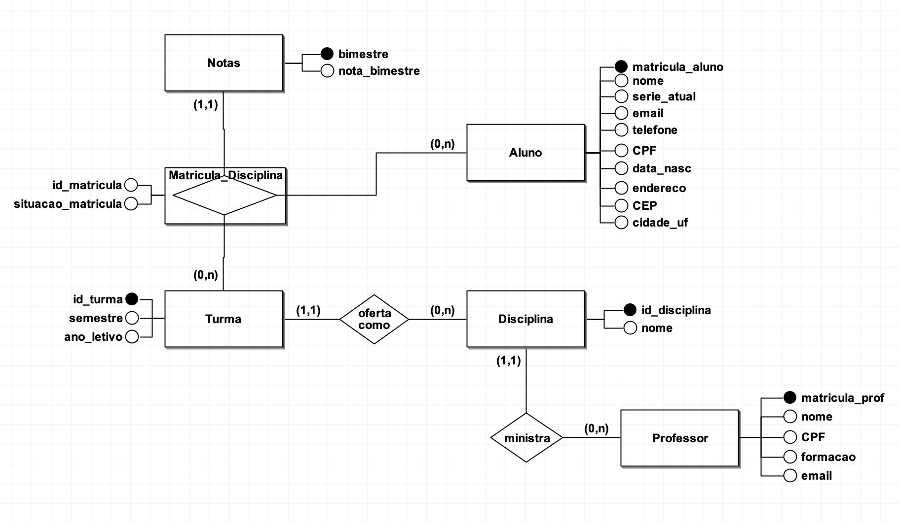
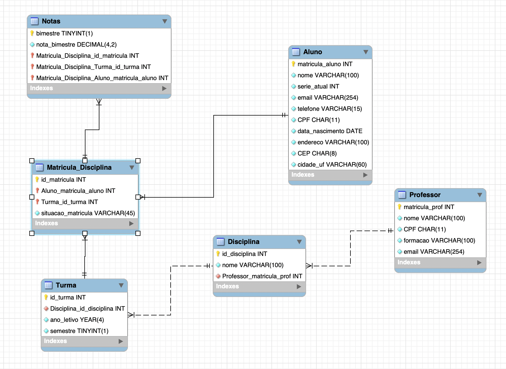

# Sistema de Banco de Dados para Gestão Acadêmica

Projeto acadêmico de um banco de dados relacional desenvolvido para gerenciar informações de uma instituição de ensino.

A solução permite armazenar e relacionar dados de alunos, professores, disciplinas, turmas, matrículas e notas bimestrais, possibilitando o acompanhamento da situação e do desempenho acadêmico dos estudantes.

## Objetivo

Desenvolver um banco de dados capaz de:

- Manter o cadastro de alunos e professores;
- Registrar disciplinas e seus respectivos professores;
- Organizar as ofertas de disciplinas por turma e período letivo;
- Controlar a matrícula dos alunos nas turmas;
- Registrar notas por matrícula e bimestre;
- Evitar registros duplicados;
- Garantir a integridade dos relacionamentos;
- Possibilitar consultas sobre a trajetória acadêmica dos alunos.

## Etapas do projeto

O desenvolvimento foi dividido em três níveis de modelagem:

### Modelo conceitual

Definição das entidades, atributos, relacionamentos e cardinalidades com base nas regras de negócio da instituição de ensino.



[Baixar o arquivo editável do modelo conceitual](modelos/modelo-conceitual.brM3)

### Modelo lógico

Conversão do modelo conceitual para uma estrutura relacional, com definição das tabelas, atributos, chaves primárias e chaves estrangeiras.



[Baixar o arquivo editável do modelo lógico](modelos/modelo-logico.mwb)

### Modelo físico

Implementação do banco de dados no MySQL por meio de comandos SQL para criação das tabelas, relacionamentos e restrições de integridade.

[Visualizar o script SQL](sql/banco_escola.sql)

## Entidades

### Aluno

Armazena os dados cadastrais dos estudantes, como nome, série atual, e-mail, telefone, CPF, data de nascimento e endereço.

A matrícula do aluno é utilizada como chave primária, enquanto a restrição `UNIQUE` aplicada ao CPF impede cadastros duplicados.

### Professor

Registra os professores da instituição, incluindo nome, CPF, formação acadêmica e e-mail.

Cada professor possui uma matrícula própria como chave primária.

### Disciplina

Representa as disciplinas oferecidas pela instituição. Cada disciplina possui um identificador único e está relacionada ao professor responsável.

### Turma

Representa a oferta de uma disciplina em determinado ano letivo e semestre.

Cada turma está vinculada a uma única disciplina.

### Matricula_Disciplina

Registra a participação dos alunos nas turmas e resolve o relacionamento muitos-para-muitos entre `Aluno` e `Turma`.

Também armazena a situação da matrícula, como ativa, concluída, trancada ou cancelada.

A restrição aplicada à combinação de aluno e turma impede que um estudante seja matriculado mais de uma vez na mesma turma.

### Notas

Armazena as notas obtidas pelos alunos em cada bimestre.

A identificação composta da nota impede que seja registrado mais de um resultado para a mesma matrícula no mesmo bimestre.

## Relacionamentos principais

```text
Professor 1 ─── N Disciplina
Disciplina 1 ─── N Turma
Aluno N ─── N Turma
Aluno ─── Matricula_Disciplina ─── Turma
Matricula_Disciplina 1 ─── N Notas
```

## Regras implementadas

- Chaves primárias para identificação única dos registros;
- Chaves estrangeiras para manutenção dos relacionamentos;
- Restrições `NOT NULL` para campos obrigatórios;
- Restrições `UNIQUE` para evitar duplicidades;
- Relacionamento muitos-para-muitos entre alunos e turmas;
- Chave composta para controle das notas bimestrais;
- Integridade referencial entre as tabelas;
- Organização das entidades para reduzir redundâncias;
- Inserção de dados fictícios para testes;
- Consultas SQL para validação das tabelas.

## Tecnologias utilizadas

- SQL;
- MySQL;
- MySQL Workbench;
- brModelo.

## Como executar

1. Faça o download ou clone este repositório;
2. Abra o MySQL Workbench;
3. Conecte-se a uma instância do MySQL;
4. Abra o arquivo `sql/banco_escola.sql`;
5. Execute o script completo;
6. Atualize a lista de schemas;
7. Consulte as tabelas criadas para verificar os registros.

## Conhecimentos aplicados

- Levantamento de requisitos;
- Definição de regras de negócio;
- Modelagem conceitual, lógica e física;
- Diagrama Entidade-Relacionamento;
- Cardinalidade;
- Modelagem relacional;
- Linguagem SQL;
- Integridade referencial;
- Criação e relacionamento de tabelas;
- Validação do banco com dados de teste.

## Observação

Todos os dados apresentados neste projeto são fictícios e foram utilizados exclusivamente para fins acadêmicos e de demonstração.

## Autoria

Desenvolvido por **Larissa da Silva Santos** como atividade acadêmica da disciplina de Banco de Dados.
